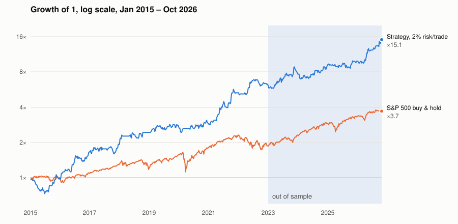
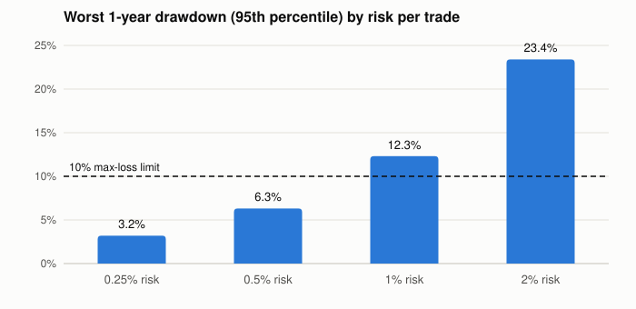

# Validating an intraday trading strategy like a risk model

This repository shows how I validated **NEATU_NQ_05**, an intraday strategy I built on the Nasdaq‑100 CFD. I treated it the
way a model validation team would treat a risk model: rules frozen before testing, a forecast written down before the
out‑of‑sample data was read, luck and multiple‑testing checks, stress tests, Monte Carlo sizing, VaR, a benchmark
comparison and an independent reproduction.

**The strategy's rules and parameters are private and are not in this repository.** What is here:
- `riskval/`: the validation toolkit, with unit tests.
- `examples/`: a public demo strategy with example parameters on synthetic data, showing the full pipeline.
- `results/`: the real validation results, as aggregate numbers only.
- `docs/`: the charts.

## The strategy in one paragraph

Intraday trend continuation on the Nasdaq‑100 CFD:
- At most one trade a day, taken only in the direction of the prevailing trend, and flat by the close.
- A fixed fraction of current equity is risked per trade; results are reported in **R** (1R = the amount risked).
- About 1.3 trades a week.

## Method

| Step | What was done |
|---|---|
| Data partition | Rules chosen on **2015–2018**; verified on **2019–2022** without re‑tuning; **out of sample 2023 – Oct 2026** on a different data feed and platform (TradingView, Pepperstone). |
| Pre‑registration | Every test plan hashed (SHA‑256) before it ran; deviations logged. |
| Frozen forecast | Before reading the out‑of‑sample export, a 5 %–95 % range for each metric was computed from 2015–2022 (block bootstrap, 10,000 paths) and hashed. |
| Luck tests | 200 random strategies on the same days with the same stops and exits; a bootstrap confidence interval for average R; the Deflated Sharpe Ratio across the 2,376 variants of the strategy family. |
| Stress tests | Costs ×2 and ×3, entry one bar late, extra stop slippage, eleven one‑step changes to the settings. |
| Risk | Block‑bootstrap Monte Carlo of compounded equity at 0.25 %–2 % risk per trade; historical daily VaR and Expected Shortfall. |
| Benchmark | S&P 500 buy & hold: CAGR, Sharpe, drawdown, correlation, beta and alpha with t‑statistics. |
| Second market | The S&P 500 CFD with identical rules and no market‑specific tuning. |
| Reproduction | Research engine (Dukascopy data, 1‑minute exit simulation) vs TradingView (Pepperstone data), trade by trade. |

Costs (spread, slippage, commission) are included everywhere.

## Results

### The same edge in every period (Nasdaq‑100 CFD, TradingView)

| | Design 2015–18 | Check 2019–22 | **Out of sample 2023–26** |
|---|---|---|---|
| Trades | 238 | 289 | 269 |
| Profit factor | 1.44 | 1.41 | **1.44** |
| Win rate | 52.9 % | 56.7 % | 55.4 % |
| Net result | +49R | +50R | +50R |
| Max drawdown | 15.3R | 8.6R | 12.8R |
| Sharpe | 1.12 | 1.14 | 1.20 |

### Out of sample against the frozen forecast

| Metric | Forecast 5 %–95 % (median) | Actual 2023–26 |
|---|---|---|
| Profit factor | 1.15 – 1.86 (1.47) | 1.44 |
| Win rate | 49 % – 60 % (54 %) | 55 % |
| Average R | +0.07 – +0.33 (+0.20) | +0.18 |
| Net result | +17R – +79R (+48R) | +50R |
| Max drawdown | 6.0R – 16.9R (9.6R) | 12.8R |
| Trades | 208 – 268 (239) | 269 (the TradingView feed takes ~7 % more trades, measured) |

**Out‑of‑sample confidence:**
- 95 % confidence interval for average R: **+0.04 to +0.34**.
- Probability that the true edge is zero or negative: **0.7 %**.

### Is it luck?

- **Random entry time and direction**, on the same days with the same exits: median profit factor **1.05**. None of
  200 reached the real 1.47 (2015–22).
- **Random entry time with the real direction:** median profit factor **1.68**. The edge comes from choosing the day
  and the side, not the exact entry bar.
- **Deflated Sharpe Ratio** (probability of skill after correcting for multiple testing): **91 %** assuming 100
  independent variants, 64 % assuming 2,376, and 50 % assuming 10,000. The whole family of 2,376 variants is
  profitable (median Sharpe 1.20), so the edge is a property of the rule type rather than of one tuned setting.

### Benchmark: S&P 500 buy & hold



| 2015 – Oct 2026 | Strategy (2 % risk/trade) | S&P 500 |
|---|---|---|
| CAGR | 25.9 % | 11.7 % |
| Sharpe | 1.17 | 0.72 |
| Max drawdown | 25.9 % | 33.9 % |
| Correlation / beta | −0.02 / −0.02 (t −0.9) | 1 / 1 |

- **Worst S&P days:** on the 20 worst S&P days, the S&P averaged −5.2 % per day and the strategy +0.6 % per day.
- **Out of sample (2023–26):** the S&P alone had the higher Sharpe (1.31 vs 1.23) in a strong bull market. A 50/50
  mix reached Sharpe **1.70** with an **11.4 %** max drawdown, so the value is diversification.

### Stress tests (profit factor)

| Scenario | Research 2015–18 | Research 2019–22 | TradingView 2023–26 |
|---|---|---|---|
| Base | 1.52 | 1.43 | 1.44 |
| Costs ×2 | 1.36 | 1.41 | 1.36 |
| Costs ×3 | 1.25 | 1.38 | 1.29 |
| Entry one bar late | 1.33 | 1.46 | – |
| Extra stop slippage 3 bp | 1.28 | 1.25 | 1.27 |

Eleven one‑step changes to the settings keep the profit factor between **1.37 and 1.73**: a plateau, not a fragile
peak.

### Risk sizing: Monte Carlo and VaR



| Risk per trade | 1‑year max drawdown (95th pct) | P(10 % drawdown within 1 year) | Median 1‑year return |
|---|---|---|---|
| 0.25 % | 3.2 % | 0.0 % | +3.0 % |
| 0.5 % | 6.3 % | 0.2 % | +6.1 % |
| 1 % | 12.3 % | 13.2 % | +12.2 % |
| 2 % | 23.4 % | 71.6 % | +24.5 % |

**Daily figures at 2 % risk:**
- VaR 99 %: 2.1 %
- Expected Shortfall 99 %: 2.5 %
- Worst day: −5.2 % (19 Oct 2023), when price jumped through the stop for −2.6R. Stops do not cap losses in fast markets.

### Second market and reproduction

- **S&P 500 CFD** (identical rules, never tuned on it): profit factor 1.66 (2015–18), 1.49 (2019–22) and **1.19**
  (2023–26). Out of sample this is positive (+19.7R) but **not statistically significant** (95 % interval
  0.90 – 1.57). The S&P 500 CFD's 2015–22 data was part of the design sample together with the Nasdaq‑100; from 2023
  it is unseen.
- **Research engine vs TradingView, 2015–22:**
  - 96 % of research trades were also taken on TradingView, 472 of 473 in the same direction.
  - Per‑trade results correlate at 0.88.

## Limitations

- **The evidence rests on one market:** about 270 out‑of‑sample trades, with a profit‑factor interval of 1.08–1.91.
- **The second market is weak:** positive after 2022 but not significant.
- **Execution is the main sensitivity:** stop slippage in fast markets can turn a −1R loss into −2.6R.
- **Many variants were explored on 2015–22:** the Deflated Sharpe Ratio depends on how many of them count as
  independent (50 %–91 %).
- **The live track record is short:** the evidence is mostly backtests.
- **A single strategy:** the equity curve and the risk rest on one edge.
- **Next steps:**
  - A forward test at 0.25 %–0.5 % risk, with a kill switch if the rolling 100‑trade profit factor drops below 1.
  - A yearly re‑validation against a newly frozen forecast.
  - Adding strategies that are uncorrelated with this one, to smooth the combined equity curve and spread the risk.
- **Results are CFD backtests:** the 2 % compounding figures use leverage, so compare Sharpe and drawdown, not raw
  return, with an unlevered index.

## Run it

```
pip install -r requirements.txt
python -m pytest -q              # 12 unit tests, incl. a look-ahead test and a no-edge-on-random-data test
python -m examples.demo_orb      # the full pipeline on a demo strategy and synthetic data
```

The demo strategy is a plain opening‑range breakout with example parameters on random‑walk data. The toolkit should
find **no edge** there. It does: profit factor 0.95, and the confidence interval spans zero. An earlier version
showed a false edge (profit factor 1.15) because stop‑outs were booked at exactly −1R; the regression test
`test_toolkit_finds_no_edge_on_random_data` guards against that bias.

## Keeping the strategy private

- **The real rules** live in a private file kept outside this repository (`config/private.toml` is also git‑ignored).
  The template `config/private.example.toml` shows its shape.
- **A privacy check blocks leaks.** `tools/check_private.py --private <path>` refuses any file containing a string from
  the private file's `[forbidden]` list. It runs before every commit once enabled with
  `git config core.hooksPath .githooks`.
- **Raw data and platform exports are git‑ignored:** they are licensed or account data.

## Layout

```
riskval/      metrics, bootstrap, monte carlo, VaR/ES, deflated Sharpe, benchmark, reconciliation, TradingView reader
examples/     demo strategy (example parameters, synthetic data)
tests/        unit tests
results/      summary.json: the real validation results, aggregates only
docs/         charts
tools/        check_private.py (pre-commit privacy check)
```
